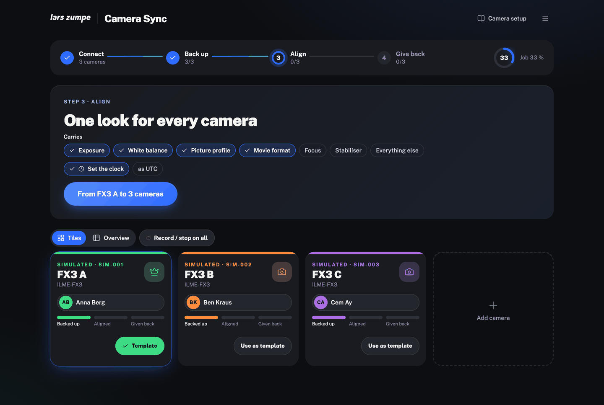
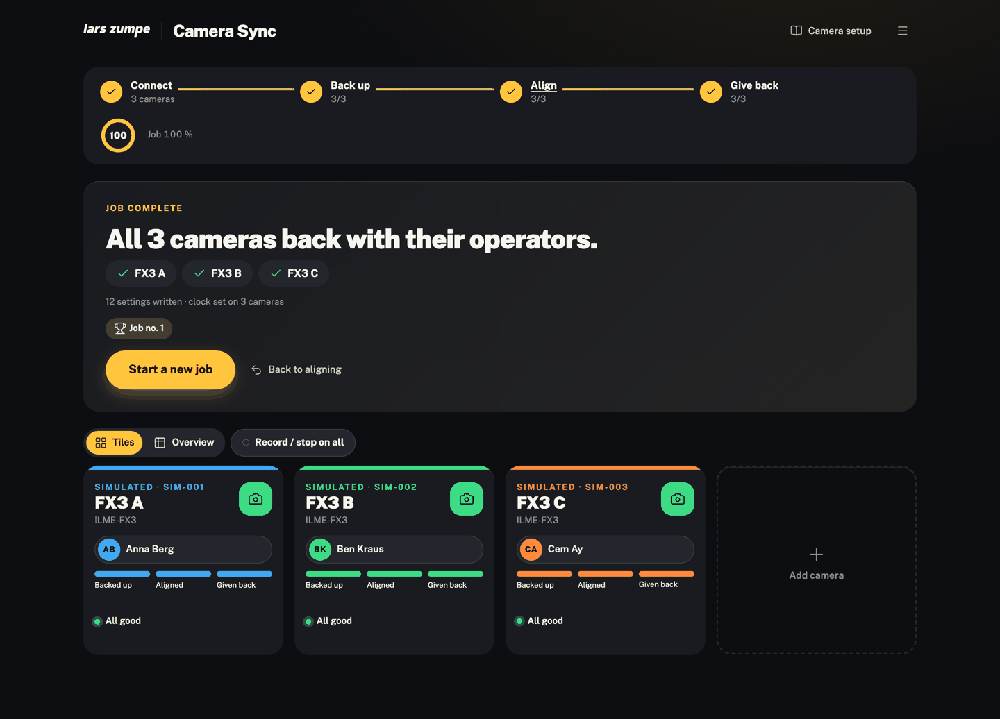
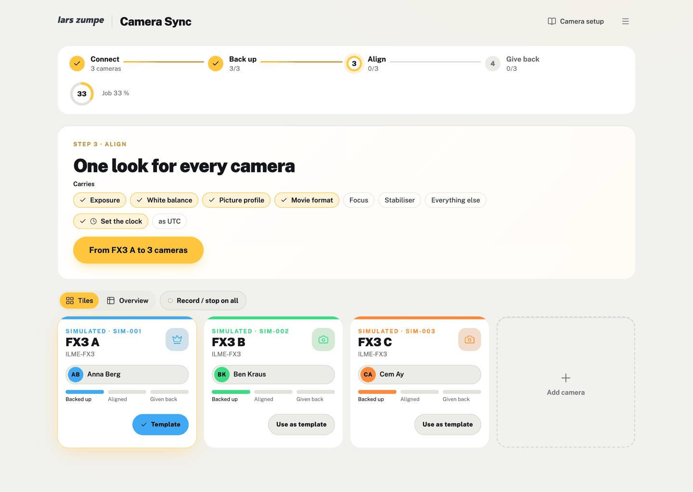
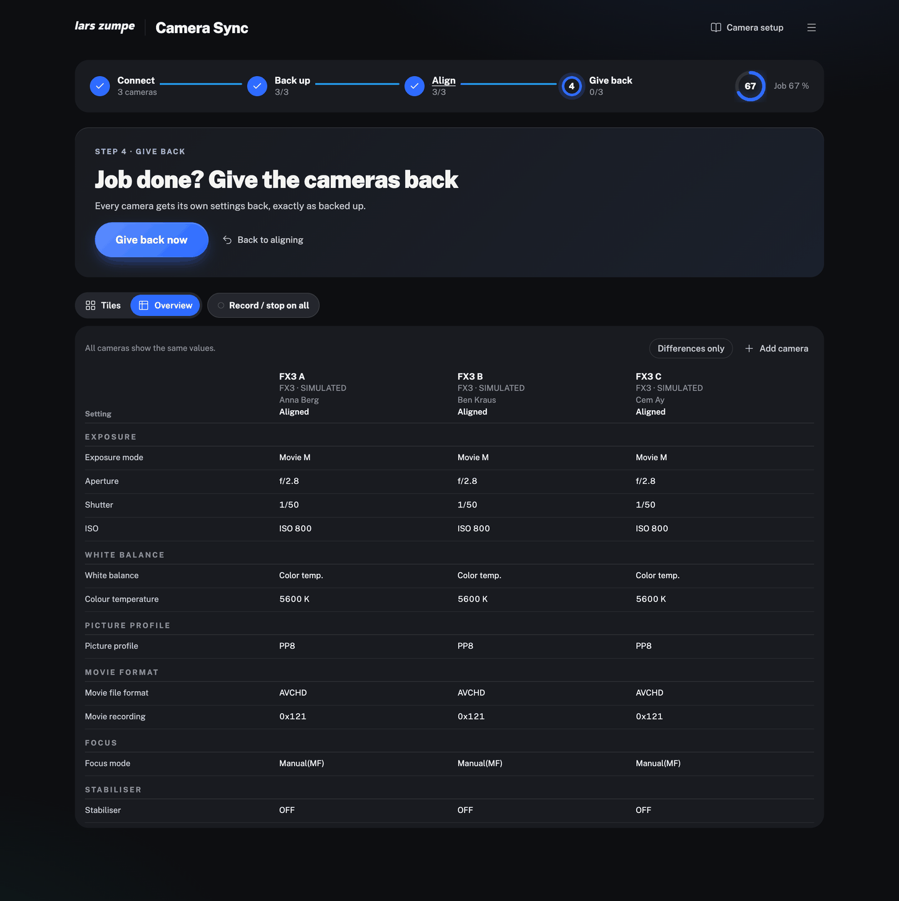
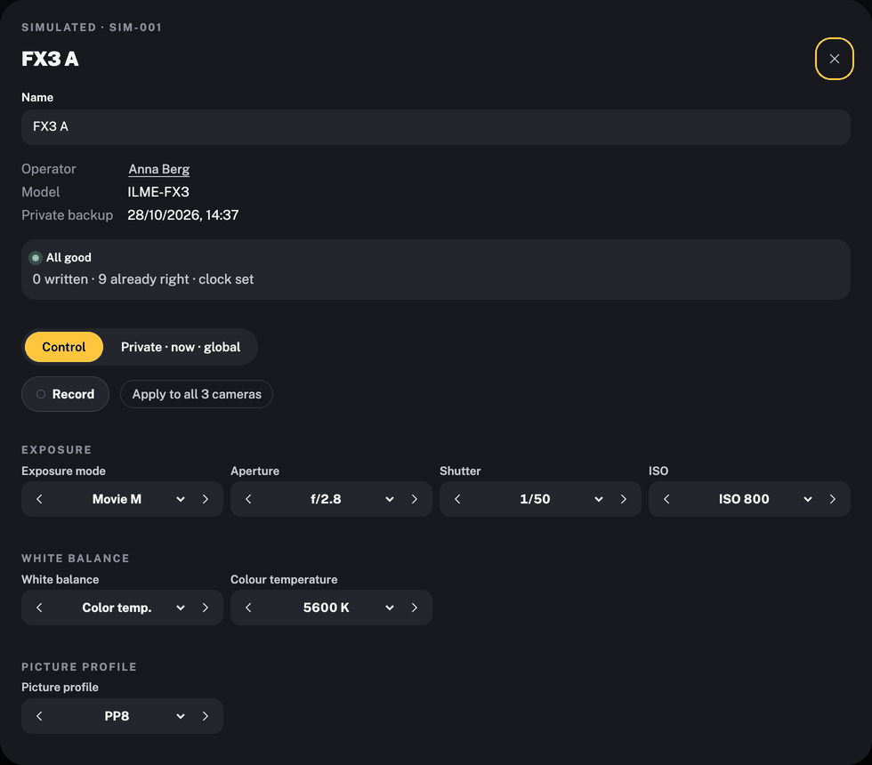
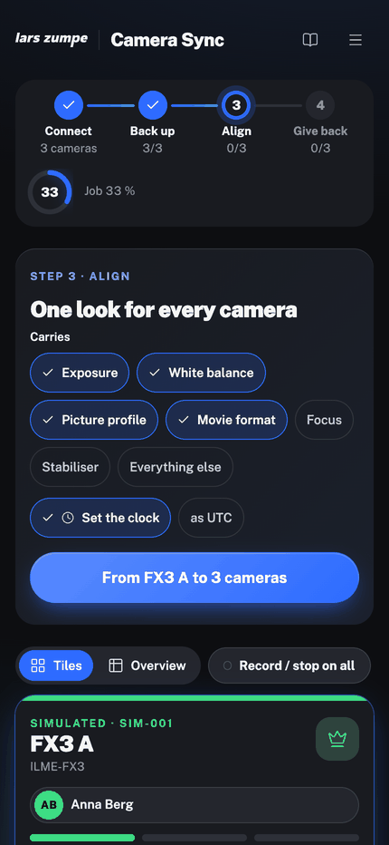

<p align="center">
  <picture>
    <source media="(prefers-color-scheme: dark)" srcset="docs/brand/lzm_hauptlogo_offwhite.svg" />
    
  </picture>
</p>

<h1 align="center">LZ Camera Sync</h1>

<p align="center">
  <b>One setup for every camera on the job — and each camera back to its owner afterwards.</b><br />
  Back up, align and restore the settings of several Sony cameras, starting with the FX3.
</p>

<p align="center">
  <a href="https://github.com/larszu/lz-camera-sync/releases/latest"></a>
  
  
  
</p>

<p align="center">
  <a href="https://github.com/larszu/lz-camera-sync/releases/latest">
    
  </a>
</p>

<p align="center">
  <b>Camera setup:</b>
  <a href="docs/camera-setup.md">English</a> ·
  <a href="docs/kamera-einrichten.md">Deutsch</a>
  <sub>— FX3 and A7 IV over USB and Wi-Fi, step by step</sub>
</p>

<p align="center">
  
</p>

---

## A job in four steps

The app always shows one next step and one big button for it. A track at the top
counts every camera through the job; each tile fills three checkpoints —
*backed up*, *aligned*, *given back*.

| | Step | You do | The app does |
| --- | --- | --- | --- |
| **1** | **Connect** | Plug the cameras in over USB, or connect over Wi-Fi | Each body appears as a tile: FX3 A, FX3 B … |
| **2** | **Back up** | *Back up now* | Reads every camera completely and stores it under its serial — the way its operator set it up |
| **3** | **Align** | *Use as template* on the camera that is right, pick what carries over | Writes the template and the current time to every camera, reads each one back and checks it |
| **4** | **Give back** | *Give back now* | Every camera gets its own backup back |

*Cancel* stops a running alignment; *Undo the changes* puts the touched cameras
back. A camera that joins mid-job starts at step 1 on its own, and one that
already carries the global setup is never backed up again — so no private backup
is overwritten. No camera at hand? *Try it with 3 simulated cameras* runs the
whole job in the app or in the browser.

## Why LZ Camera Sync

| | |
| --- | --- |
| **Everything is backed up** | The camera hands over every setting with its value and allowed values in one call; each one it reports as writable goes into the backup — not just what the app knows. |
| **Checked, not hoped** | After every write the camera is read back. Values it did not take are named on the tile and in the camera sheet, which lists *private · now · global* per setting. |
| **Cameras belong to people** | Pick the operator on the tile; the backup stays with the camera's serial. Zoom and focus positions are never written, so a camera on a rig does not move when it is given back. |
| **Control from the app** | Every setting as a stepper through the values the camera offers, live view from each body, record/stop per camera or on all, LUTs from a library into the user slots. |
| **Setups without a camera** | Prepare a setup from a model profile, for several camera types at once — each type gets its own tab for values it needs differently. |
| **No Sony SDK** | Speaks PTP with Sony's vendor extension directly, the same path the [LZ Camera Bridge](https://github.com/larszu/lz-camera-bridge) uses. One TypeScript core runs on desktop and phone; settings and allowed values come from the camera itself, so nothing is tied to one model. |
| **Offline** | All data stays on the device and exports as one JSON file; nothing loads from the web. |

## The screens

<table>
  <tr>
    <td width="50%" valign="top" align="center">
      <br />
      <b>Job complete</b>
    </td>
    <td width="50%" valign="top" align="center">
      <br />
      <b>Light appearance</b>
    </td>
  </tr>
  <tr>
    <td width="50%" valign="top" align="center">
      <br />
      <b>Overview</b> — <sub>values that differ stand out</sub>
    </td>
    <td width="50%" valign="top" align="center">
      <br />
      <b>Camera sheet</b> — <sub>control the body setting by setting</sub>
    </td>
  </tr>
</table>

<p align="center">
  <br />
  <b>Phone</b> — the same job, one thumb
</p>

Two looks, menu → *Style*: **Modern** (default, shown here) and **Classic**, the
quiet LZM tool look. Light and dark follow the system.

## Platforms

| | USB | Wi-Fi (PTP/IP) | Download |
| --- | --- | --- | --- |
| **macOS** | ✓ libusb | ✓ | `.dmg` (Apple Silicon, Intel) |
| **Windows** | ✓ libusb, WinUSB driver needed | ✓ | Installer, portable `.exe` |
| **Linux** | ✓ libusb | ✓ | `.AppImage` |
| **Android** | native plugin in progress | native plugin in progress | `.apk` |
| **iOS** | no raw USB on iOS | native plugin in progress | — (needs an Apple developer account) |

The Android build runs the full interface with simulated cameras today; the native
plugins are tracked in [#5](https://github.com/larszu/lz-camera-sync/issues/5) and
[#6](https://github.com/larszu/lz-camera-sync/issues/6), details in
[docs/mobile.md](docs/mobile.md).

**First start:** macOS blocks the first start of a downloaded copy (ad-hoc signed,
not notarised) — *System Settings → Privacy & Security → Open Anyway*. Windows
SmartScreen: *More info → Run anyway*. The app checks GitHub for updates itself
and installs them on Windows and Linux.

## Checked on a real camera

**FX3, firmware 7.00, over Wi-Fi with Access Authentication** (2026-10-07): tunnel,
login and handshake in under 2 s, all 369 properties read, 119 writable, clock set,
and a whole job on the body — back up (118 values), align, give back, afterwards
every value **identical** to the backup. Also on an FX3 and an A7 IV (fw 5.00)
together: found automatically, live view, settings on both at once, a LUT into
User16 of the FX3 and out again. Open on the body
([#3](https://github.com/larszu/lz-camera-sync/issues/3)): values behind the
exposure mode, USB, several cameras at once.

`npm run probe -- <ip> [user] [password]` repeats the read-only check against any
camera; it writes nothing. The whole flow is also tested against simulated FX3
bodies — USB framing byte for byte, PTP/IP over split TCP packets, the SSH tunnel
against a local server: `npm test`.

## Prepare the camera

*Remote Shooting* on, no smartphone connected. **USB:** data cable, choose *Remote
Shooting* on the camera. **Wi-Fi:** the app finds the camera by itself; the first
time enter user and password from *Access Authen. Info* and confirm the
fingerprint, after that one click. Step by step for the FX3 and A7 IV, and what to
check when no camera shows up: **[docs/camera-setup.md](docs/camera-setup.md)** ·
[Deutsch](docs/kamera-einrichten.md) — the same guide is in the app.

<details>
<summary><b>Values behind the exposure mode</b></summary>

<br />

A camera in P, A or S keeps its own manual shutter, ISO and aperture for M, but
does not offer them while it is in P. At back-up the app switches the camera to the
M of the same family for a moment (still M, Movie M, S&Q M …), reads what it keeps
there, and puts it back. At give-back it writes those values in M and returns the
camera to its own mode. A body whose mode is set by a dial is left alone.

</details>

<details>
<summary><b>How it talks to the camera</b></summary>

<br />

| Step | PTP operation |
| --- | --- |
| Session | `OpenSession`, Sony SDIO handshake (protocol 3.00) |
| Back up | `GetAllExtDevicePropInfo` 0x9209 — every property, value, type, allowed values |
| Write | `SetExtDevicePropValue` 0x9205, exposure mode and movie format first, failures retried once after a fresh read |
| Clock | `DateTimeSet` 0xD223, string `YYYYMMDDThhmmss.s±hhmm` |
| Mode change | `ExposureProgramMode` 0x500E, then 500 ms before exposure values |
| Wi-Fi | PTP/IP on TCP 15740; with Access Authentication through SSH (port 22, `aes128-ctr`, forward to the camera's `localhost:15740`) |
| Never written | buttons (0xD2C0–0xD2FF), zoom and focus positions |

Opcodes and data layout follow Sony's Camera Control PTP 3 Reference and
libgphoto2. All protocol code lives in `src/core` (plain TypeScript, no Node APIs);
a platform only provides byte pipes — USB bulk and TCP — through `window.lzHost`
([electron/ptp-host.d.ts](electron/ptp-host.d.ts)).

</details>

## Build from source

Requires [Node.js](https://nodejs.org/) 22+.

```bash
npm install
npm run dev            # browser, http://localhost:4192 (simulator only)
npm run electron:dev   # desktop app with USB and Wi-Fi
npm test               # core tests + SSH tunnel
npm run fake-camera    # a simulated FX3 on 127.0.0.1:15740 (pairing style)
npm run fake-camera -- --ssh 2222   # with Access Authentication; app with LZ_SSH_PORT=2222
npm run dist:mac       # or dist:win, dist:linux
```

Releases are built by [`.github/workflows/release.yml`](.github/workflows/release.yml)
when a `v*` tag is pushed. Built with Electron, Capacitor, React 19, TypeScript,
Vite and Lucide icons.

## Author & support

Built and maintained by **Lars Zumpe** — Lars Zumpe Medienproduktion.
If the app saves you time on your next shoot:
[PayPal](https://paypal.me/larszumpe). Donations are optional; the app stays free
to use.

## Licence

Source available, not open source. Free to use the released builds, including
commercially; no redistribution or derivative works without written consent. See
[LICENSE](LICENSE).
